# Rune Mage: The Emberbound Grimoire

A spellcasting game for **Meta Quest 3 / 3S** in **passthrough mixed reality**. No weapons and no controllers: you draw a magic circle in the air with your finger, then cast it by speaking its word or pushing your palm. Your real room becomes the battlefield: cracks spread over your walls, the walls break open, and creatures force their way in and advance toward you, but they never come closer than a safe distance.

Unity 6 (6000.2.7f2), URP, Meta XR All-in-One SDK, OpenXR.

## Screenshots

| Main menu | Quest board |
|---|---|
| 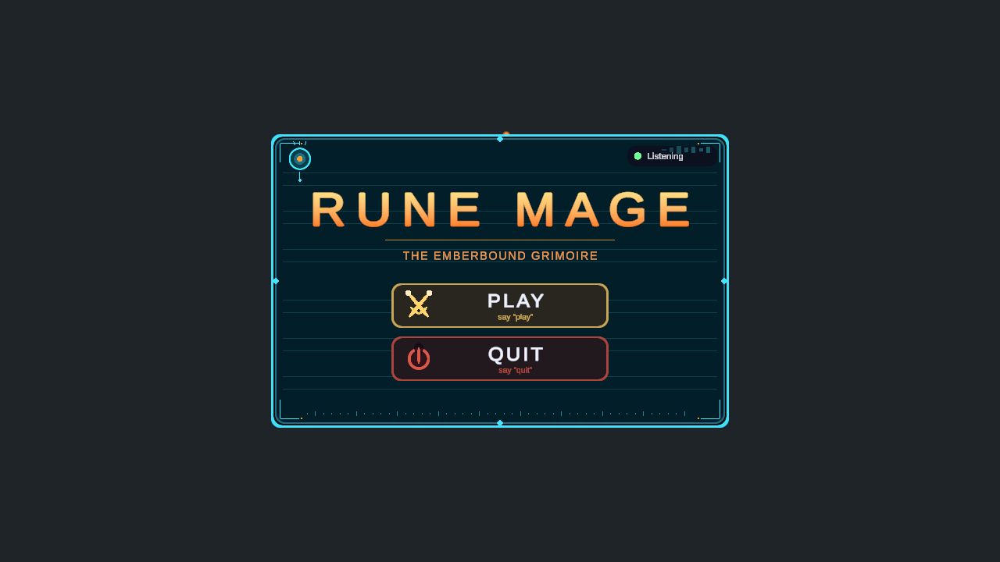 | 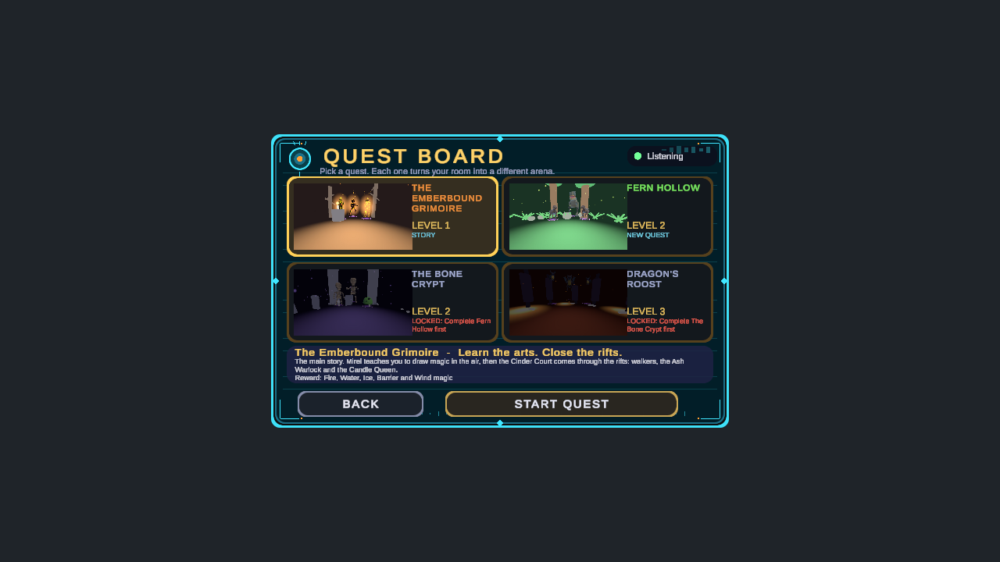 |

| Magic list | Achievements |
|---|---|
| 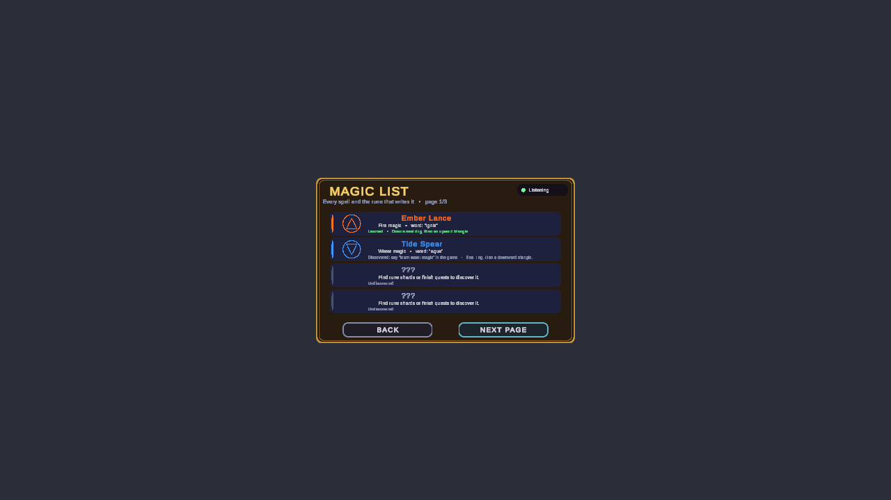 | 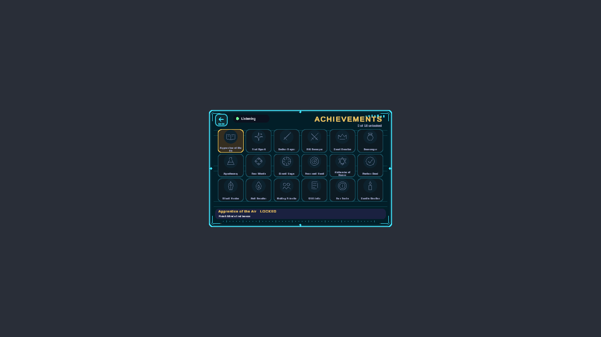 |

Casting:

| Seal ring ready | Fireball | Grimoire |
|---|---|---|
| 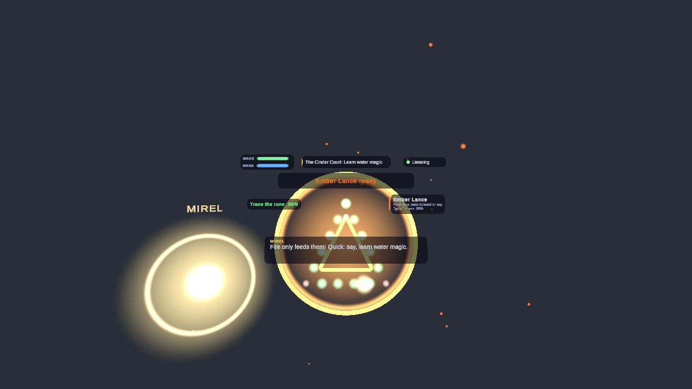 | 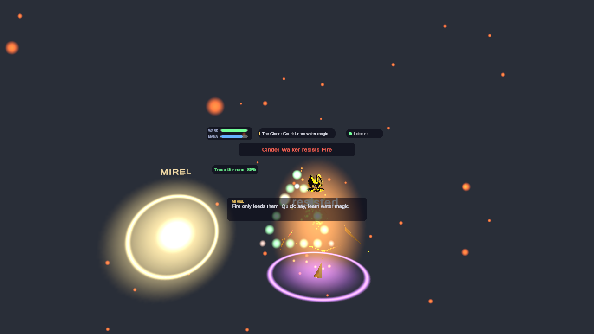 | 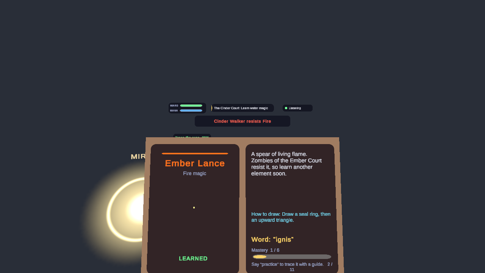 |

## Quest board

After **Play** the menu offers the **Quest Board**, a level select with a preview picture, name, level and status for each quest. Point at a card to pick it, read its description and reward in the strip below, then **Start Quest** (or say "start quest"; saying a quest's name picks it).

| The Emberbound Grimoire | Fern Hollow | The Bone Crypt | Dragon's Roost |
|---|---|---|---|
| 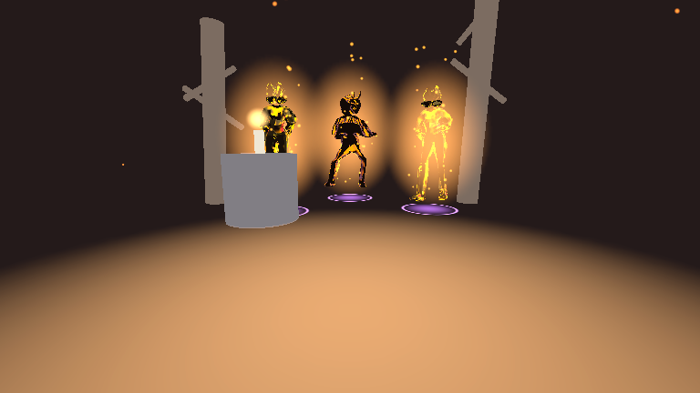 | 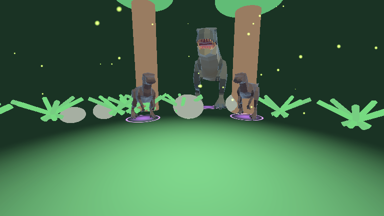 | 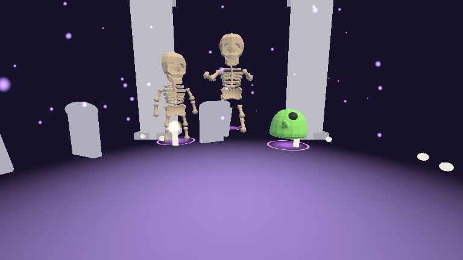 | 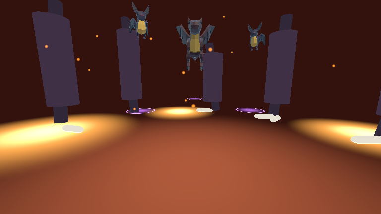 |
| The story campaign: learn to draw magic, then the Cinder Court, the Ash Warlock and the Candle Queen. | Raptors, a horned brute and the Tyrant of the Hollow. Ice and lightning. | Skeletons, slimes and the Bone Warden. Stone shatters bones, fire melts slimes. | Bats, then the dragon Cinderwing. Fire cannot hurt a dragon: bring ice and water. |

- Quests unlock in a chain: the story opens Fern Hollow once the tutorial is done, each later quest needs the one before it.
- Each quest turns your room into its own arena (ferns and trunks, tombs and candles, obsidian spires and lava), placed 1.7 to 3.2 m away so you never have to walk. Props stand on the real scanned floor and keep clear of scanned furniture.
- A quest is a few waves and a boss. If your ward breaks the wave restarts, it never ends the quest. The reward is saved and the quest is marked complete.

### The invasion

Every wave of every quest opens with the room being invaded:

1. Ominous rumble, then glowing, branching cracks spread across your real walls.
2. The walls break open into ragged dimensional doorways that reach the floor, with fragments flying out and landing on the floor, swirling energy, sparks and smoke.
3. Eyes peer through the opening, then the creatures force their way out: raptors leap, brutes and bosses stride out with dust and thuds, bats and the dragon swoop, slimes drop and squash.
4. They turn to you and advance, stopping at a minimum distance (`CombatSystem.MinEnemyDistance`, 1.8 m by default) and attacking with projectiles and magic.
5. Some cracks stay closed until a boss calls reinforcements, then break open. The openings close when the wave ends.

Each quest picks an `InvasionProfile` (colours, number and size of the openings, timing, intensity), so one system gives every quest its own invasion. It is built in `InvasionDirector`, `DimensionalPortal` and `WallSiteFinder`.

## Room scanning

The scan scene runs between the quest board and the game, built on Meta's MR Utility Kit and Space Setup:

1. **Load the room** from the headset. If there is none (or you ask to scan again), Meta's **Space Setup** opens to capture it.
2. **Look around.** Every wall, the ceiling, the floor and each piece of furniture glows orange until you look at it for a moment, then turns cyan with a chime. The panel tells you where to look next ("look up", "look to your left"). You turn on the spot, you do not have to walk.
3. **Check the scan.** It must have a floor, a ceiling, at least three walls and some size. If something is missing it says what and offers another pass; it never traps you.
4. **Identify the room.** The detected doors, windows, tables, couches, storage, screens, lamps, plants and wall art each get an outline fitted to their real size and a floating name.
5. **Start.** Say "start", poke START, or "scan again".

After this the game uses the scan for placement: the floor height comes from the scanned floor (a ray onto the floor anchor, so nothing hovers), spots must be inside the room and clear of scanned furniture, and cracks open only on real walls away from doors and windows. With no scan data everything falls back to a safe arc around the player. A second quest in the same session skips the scan.

## Magic circles

Drawing follows rules, so you can invent spells instead of looking them up:

- The **ring** is the circle: neater is steadier, bigger is stronger.
- The rune in the **core** is the body of the spell; a rune on the **rim** infuses it. Water in the core with ice on the rim is a freezing torrent, ice in the core with water on the rim is a different spell.
- Two runes on the same layer **fuse**.
- **Signs** on the rim modify delivery: a straight stroke is a beam (faster), a small loop is a burst (explodes), a chevron seeks.
- Mixed circles are released by speaking both element words.

You write on an **invisible drawing plane** about 0.7 m in front of you (it glows faintly when your hand is near, so you can see where to write). Raising your hand elsewhere draws nothing.

Open the **grimoire** with your open left hand; it rides on that hand, book-sized, with an icon menu (Spells, Quests, Items, Trophies, Help). Say "close grimoire" to close it. The Help tab lists the circle rules and every voice command.

## Scenes

Build order: `MainMenu`, `Quests`, `Scan`, `Game`, `Achievements`, `MagicList` (in `Assets/Scenes`).

- **MainMenu**: the title with Play and Quit. Play opens a second page with Quest Board, Magic List, Achievements and Inventory.
- **Quests**: the quest board.
- **Scan**: the room scan described above, then it loads the game.
- **Game**: the quest (story or a board quest), combat and bosses.
- **Achievements** (a grid of symbols, back icon top left) and **MagicList**: reached from the second menu page.

The menus, the scan panel, the HUD, the grimoire, the inventory panel and the story props are real objects in the scenes (see `MenuCanvas`, `ScanPanel`, `HUD`, `Grimoire`, `InventoryPanel`, `Props`), so they can be seen and edited in the Scene view without pressing Play. Menus are plate-sized (about 37 x 24 cm), 50 cm in front of you at eye height, with a sci-fi layer (cyan frames, corner brackets, scan lines, an eye emblem) over the gold fantasy trim.

## Playing

- **Hands only, no controllers**: pinch on the drawing plane to write, push your palm forward to cast, open your left hand for the grimoire, point or pinch at buttons.
- **Voice**: every action also works by voice. Say "what can I say" at any time.
- **Spells**: fire, water, wind, lightning, earth, ice, barrier, heal, plus any mixed circle you invent.
- **Inventory**: monsters drop potions and keepsakes. Say "drink health potion" or "use mana potion".

## Meta SDK and building blocks

The scenes use Meta Building Blocks: Camera Rig, Passthrough, Real Hands, MR Utility Kit, the Interaction SDK's Poke and Ray interactions, and the Voice SDK's Speech to Text (Dictation) and Speak Text blocks. The Meta app id is stored in `Assets/Resources/OculusPlatformSettings.asset`; set your own package name and complete the Data Use Checkup on the developer dashboard before submitting.

### Voice needs your own Wit.ai config

Speech to Text and Speak Text use a Wit.ai app. The configuration asset (`Assets/Scenes/voice/voice_input.asset`) and `ProjectSettings/wit.config` hold a client token, so they are **not in this repo**. After cloning:

1. Create or open your Wit.ai app and get its client access token.
2. In Unity, `Meta > Voice SDK > Get Started` (or the Speech to Text building block) creates the configuration named `voice_input`.
3. Assign it on the `[BuildingBlock] Dictation` and `[BuildingBlock] Speak Text` objects in each scene.

Without a Wit configuration the game falls back to Android speech recognition on the headset, and to hand gestures where voice is unavailable.

### Quest Link

Set Meta Quest Link as the active OpenXR runtime, turn on passthrough over Link and hand tracking over Link in the Link app, and use only OpenXR in `XR Plug-in Management` for PC.

## Tests

PlayMode tests in `Assets/RuneMage/Tests/PlayMode`. They run headless, with scripted hands and voice, and cover the drawing plane, magic-circle rules, the quest board, a full quest playthrough, the invasion sequence, placement and the menus. A few tests (`RuneMagePreviewTests`) are marked explicit: they render the quest preview pictures and menu screenshots and only run when selected.

## Layout

- `Assets/RuneMage/Scripts`: game code (recognition, hands, magic, combat and invasion, voice, story and missions, spatial and scan, UI)
- `Assets/RuneMage/Art`, `Assets/RuneMage/Resources/Creatures`: models and textures
- `Assets/RuneMage/Resources/QuestPreviews`: the quest board pictures
- `Assets/RuneMage/Editor`: editor tools used to generate and update the scenes (batch mode)
- `Assets/Scenes`: the game scenes
- `privacy-policy`: the privacy policy page for GitHub Pages

## Credits

### Major assets

| What | Where it is used | Source and licence |
|---|---|---|
| **Meta XR All-in-One SDK** (Core, MR Utility Kit, Interaction SDK, Voice SDK, Platform) | passthrough, hands, room scanning, poke and ray buttons, speech | [Meta](https://developers.meta.com/horizon/), under Meta's SDK licence |
| **Animated LowPoly Dinosaurs** by Quaternius | Rift Raptor, Horned Brute, Tyrant of the Hollow | [quaternius.itch.io/animated-lowpoly-dinosaurs](https://quaternius.itch.io/animated-lowpoly-dinosaurs), [CC0](https://creativecommons.org/publicdomain/zero/1.0/) |
| **Animated Monsters** by Quaternius | Cinderwing the dragon, the skeletons, the Bone Warden, slimes, bats | [opengameart.org/content/lowpoly-animated-monsters](https://opengameart.org/content/lowpoly-animated-monsters), [CC0](https://creativecommons.org/publicdomain/zero/1.0/) |
| **Wit.ai** | speech to text and text to speech through the Voice SDK | [wit.ai](https://wit.ai), you supply your own app and token |
| **glTFast** (Unity package) | importing the Hana character model | [Unity glTFast](https://docs.unity3d.com/Packages/com.unity.cloud.gltfast@latest) |
| **Hana** (`Unagirl.vrm`, a VRM avatar) | the healer character | taken from the LearnTwin project's `assets` folder, whose README says to check each VRM model's licence before redistributing. **Confirm this licence before shipping.** The model file is not in this repo. |
| **Bob, Klevin, Neko** and the character animations (idle, pointing, sword casting, ...) | the other three characters | Mixamo-rigged models and Mixamo-style clips taken from the Crimson Valor reference project. **Confirm the licences before shipping.** |
| **Flame enemies** (Cinder Walker, Ash Warlock) and the **Candle Queen** | story enemies | models and animations that came from other Unity projects (Inferno Overdrive, Humpty Bumpy). The Candle Queen is a Chandelure-style lantern model, which is Nintendo/Game Freak's character design. **Confirm you may publish these before shipping.** |

Sound effects are synthesised in code. The spell recognition is a $P point-cloud recogniser (Vatavu, Anthony and Wobbrock, 2012), written for this project.

### Inspiration (no code or assets copied)

- Meta's **First Encounters** (the ceiling breaking open) and Meta's open-source samples **Unity-CrypticCabinet** (room setup and scene loading flow) and **Unity-TheWorldBeyond** (placing things on real surfaces).
- The **Witch Hat Atelier Spell Simulator** by [ytnrvdf](https://ytnrvdf.github.io/wha-spell-simulator) (a fan project), and *Witch Hat Atelier* by Kamome Shirahama, for the idea of a ring, element runes and modifying signs, which became the magic-circle rules.

Small props (trees, the stand and candle, the plate) and the simple shapes of the quest arenas are not listed.
