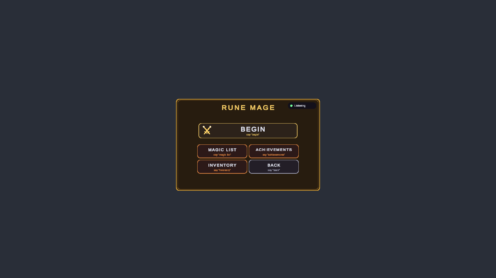
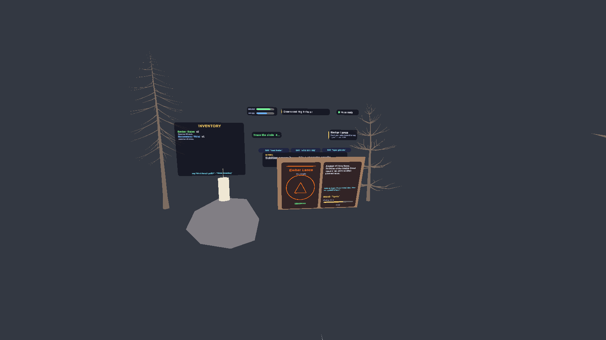

# Rune Mage: The Emberbound Grimoire

A spellcasting game for **Meta Quest 3 / 3S** in **passthrough mixed reality**. No weapons: you draw a seal ring and a rune in the air with your finger, then cast it by speaking its word or pushing your palm. Enemies spawn in your real room (MRUK) and keep their distance.

Unity 6 (6000.2.7f2), URP, Meta XR All-in-One SDK, OpenXR.

## Screenshots

| Main menu | After Play |
|---|---|
|  |  |

| Magic list | Achievements |
|---|---|
|  |  |

Casting:

| Seal ring ready | Fireball | Grimoire |
|---|---|---|
|  |  |  |

The Game scene in the editor (trees, candle stand, HUD, grimoire and inventory panel are saved objects you can edit before Play):

## Scenes

Build order: `MainMenu`, `Game`, `Achievements`, `MagicList` (in `Assets/Scenes`).

- **MainMenu**: the title with Play and Quit. Play opens a second page with Begin/Continue, Magic List, Achievements and Inventory.
- **Game**: the adventure (tutorial, quests, combat, boss).
- **Achievements** and **MagicList**: paged lists, reached from the second menu page.

The menu UI, the HUD, the grimoire, the inventory panel and the environment props are real objects in the scenes (see `MenuCanvas`, `HUD`, `Grimoire`, `InventoryPanel`, `Props`), so they can be seen and edited in the Scene view without pressing Play.

## Playing

- **Hands only, no controllers**: pinch to draw ink, push your palm forward to cast, hold the left palm up for the grimoire, swipe to turn pages.
- **Voice**: every action also works by voice. Say "what can I say" at any time. Menu buttons also work by holding a fingertip on them, or pinching.
- **Spells**: fire, water, wind, lightning, earth, ice, barrier, heal, plus hidden combinations.
- **Inventory**: monsters drop potions and keepsakes. Say "drink health potion" or "use mana potion".

## Meta SDK and building blocks

The scenes use Meta Building Blocks: Camera Rig, Passthrough, Real Hands, MR Utility Kit, and the Voice SDK's Speech to Text (Dictation) and Speak Text blocks.

### Voice needs your own Wit.ai config

Speech to Text and Speak Text use a Wit.ai app. The configuration asset (`Assets/Scenes/voice/voice_input.asset`) and `ProjectSettings/wit.config` hold a client token, so they are **not in this repo**. After cloning:

1. Create or open your Wit.ai app and get its client access token.
2. In Unity, `Meta > Voice SDK > Get Started` (or the Speech to Text building block) creates the configuration named `voice_input`.
3. Assign it on the `[BuildingBlock] Dictation` and `[BuildingBlock] Speak Text` objects in each scene.

Without a Wit configuration the game falls back to Android speech recognition on the headset, and to hand gestures where voice is unavailable.

### Quest Link

Set Meta Quest Link as the active OpenXR runtime, turn on passthrough over Link and hand tracking over Link in the Link app, and use only OpenXR in `XR Plug-in Management` for PC.

## Tests

PlayMode tests in `Assets/RuneMage/Tests/PlayMode`. They run headless, with scripted hands and voice.

## Layout

- `Assets/RuneMage/Scripts`: game code (recognition, hands, magic, combat, voice, story, UI)
- `Assets/RuneMage/Art`: flame models and textures
- `Assets/RuneMage/Editor`: editor tools used to generate and update the scenes (batch mode)
- `Assets/Scenes`: the four game scenes
